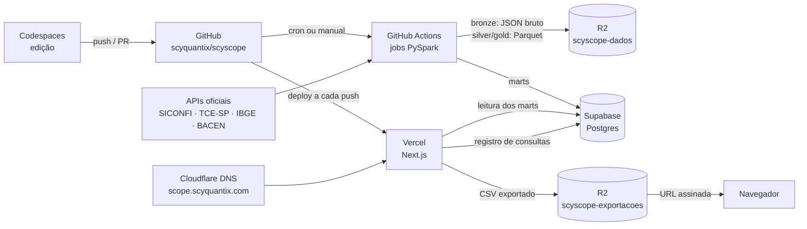
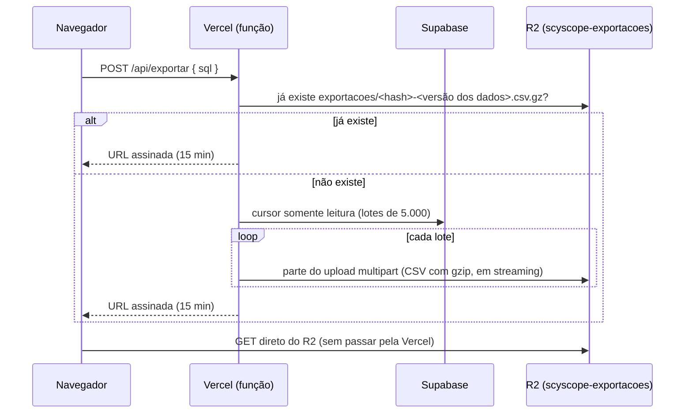

# Projeto de deploy do ScyScope

Status: **proposta v2**, 21/10/2026. Nada aqui está implementado; o passo a passo do MVP está em [`mvp-passo-a-passo.md`](mvp-passo-a-passo.md).

Decisões já tomadas:
- O fluxo é Codespaces → GitHub → Actions/PySpark → R2 → Supabase → Vercel → Cloudflare.
- O MVP começa nos **planos gratuitos**, para validar.
- **Todas as consultas** são registradas numa tabela para análise das mais frequentes (seção 5).
- Há **duas versões** de escopo de dados: **A**, só Ferraz de Vasconcelos, e **B**, o estado de São Paulo inteiro (seção 3).

## 1. Fluxo



| Peça | Papel | Plano no MVP |
| --- | --- | --- |
| GitHub | Código, PRs, segredos do pipeline | Gratuito (repositório público) |
| Codespaces | Ambiente de desenvolvimento padronizado (`.devcontainer/`) | Cota gratuita da conta pessoal |
| GitHub Actions | CI do app e orquestração do pipeline | Gratuito (runners padrão em repositório público) |
| PySpark | Transformação bronze → silver → gold e carga | Roda em `local[*]` no runner |
| Cloudflare R2 | Data lake (`scyscope-dados`) e arquivos exportados (`scyscope-exportacoes`) | Gratuito (10 GB) |
| Supabase | Postgres com os marts e a tabela de consultas | Gratuito (500 MB), região `sa-east-1` |
| Vercel | Next.js | Hobby, região `gru1` |
| Cloudflare DNS | Subdomínio para a Vercel | Gratuito |

## 2. Implicações para a aplicação

O app hoje depende de arquivos SQLite locais. Na Vercel não há disco persistente e o banco passa a ser Postgres.

### 2.1 Motor de consulta: SQLite → Postgres

| Hoje | No deploy |
| --- | --- |
| `node:sqlite` com `ATTACH ... AS tce` por fonte | Postgres com **um schema por fonte** (`siconfi`, `tce`, `ibge`, `bacen`). Os nomes qualificados (`tce.despesas`) não mudam, então exemplos e links `?q=` continuam válidos. |
| Worker thread encerrada após 15 s | `statement_timeout = 15s` no papel de leitura |
| Autorizador do SQLite nega escrita | Papel `scyscope_leitor` só com `SELECT`, `default_transaction_read_only = on`, cada consulta em `BEGIN READ ONLY ... ROLLBACK` |
| Contador próprio de instruções | Mantido; o protocolo estendido do Postgres também recusa várias instruções |
| `EXPLAIN QUERY PLAN` | `EXPLAIN (FORMAT JSON)`; a aba Plano é redesenhada |
| `sqlite_master`, `pragma_table_info` | `information_schema` e `pg_catalog`; contagens por `pg_class.reltuples` |
| Descrições em `src/lib/fontes.ts` | `COMMENT ON TABLE/COLUMN`, mantidos pelas migrations |

Driver: [`postgres`](https://github.com/porsager/postgres) (postgres.js) no **transaction pooler** do Supabase (porta 6543), com `prepare: false`.

### 2.2 Dialeto SQL

- `src/lib/exemplos.ts`: `julianday` e `printf` viram aritmética de `date` e `to_char`/`format`.
- `rowid` não existe no Postgres. `siconfi.linhas` ganha a coluna `ordem`, com a posição em que a API entregou a linha. `typeof()` vira `pg_typeof()`.
- `||` e `substr` funcionam igual.

### 2.3 Consultas salvas e histórico

- **Lista pessoal** ("Salvas" e "Histórico" na lateral): o MVP local já tem login, e a lista é por usuário (`usuario_id`, com RLS emulado no SQLite; ver [`acesso.md`](acesso.md)). No deploy, ela vai para o Postgres com RLS por `auth.uid()`, e o login passa a vir do ScyHome. Isso substitui a ideia anterior de guardar a lista no `localStorage`.
- **Registro para análise:** toda execução, salvamento, exportação e compartilhamento vai **anonimamente** para o Supabase (seção 5). As duas coisas são independentes: limpar o navegador não apaga a estatística, e a estatística não guarda quem é a pessoa.

### 2.4 Limites de resposta da Vercel

Detalhado na seção 6.

### 2.5 O que sai do repositório

Quando o pipeline estiver no ar:
- **Saem:** `data/fontes/siconfi.db`, `workers/` e `scripts/sync.mjs`. O `sync.mjs` serve de referência para portar a coleta.
- **Fica no histórico do git:** o `siconfi.db` (10 MB). Tirá-lo do histórico exigiria reescrever a `main`, o que o ruleset bloqueia de propósito.

## 3. Duas versões de escopo

### 3.1 Dimensionamento

Base de cálculo: os volumes reais de Ferraz de Vasconcelos (187 mil habitantes) medidos nos bancos atuais.

| Medida em Ferraz | Valor |
| --- | --- |
| `siconfi.linhas` por ano | cerca de 10.300 (estável entre anos; o relatório tem o mesmo formato em qualquer município) |
| `tce.despesas` por ano | cerca de 39.000 (média de 2024 e 2025) |
| `tce.receitas` por ano | cerca de 2.800 |
| Texto médio por linha | 126 bytes em `tce.despesas`, 109 em `siconfi.linhas` |
| Combinações distintas de anexo, conta e coluna | 2.888, ou seja, o texto se repete muito e normaliza bem |

Extrapolação para o estado:
- **SICONFI:** são **645 municípios**. O volume é quase o mesmo por município, então a conta é direta.
- **TCE-SP:** fiscaliza **644 municípios**, todos menos a capital, que é fiscalizada pelo TCM-SP. Para a capital, só haverá SICONFI e IBGE. O volume de despesas cresce com o porte do município, mas não na mesma proporção, então uso uma faixa:
  - **piso:** proporcional à população (33 milhões de habitantes fora da capital, cerca de 176 vezes Ferraz);
  - **teto:** cada município com o volume de Ferraz (644 vezes).

| | Versão A: Ferraz | Versão B: estado de SP |
| --- | --- | --- |
| `siconfi.linhas` (2022–2026) | 48 mil | cerca de 33 milhões |
| `tce.despesas` (2024–2026) | 98 mil | entre 19 e 68 milhões |
| `tce.receitas` | 8 mil | cerca de 5 milhões |
| Postgres, tabelas como hoje (desnormalizadas) | cerca de 40 MB | entre 13 e 25 GB |
| Postgres, normalizado (seção 3.3) | cerca de 25 MB | entre 4 e 8 GB |
| R2, bronze em JSON com gzip e silver/gold em Parquet | menos de 100 MB | entre 4 e 10 GB |
| Requisições na carga inicial | cerca de 1.000 | cerca de 32 mil (SICONFI) e 41 mil (TCE-SP) |
| Requisições por semana (incremental) | cerca de 100 | cerca de 13 mil (SICONFI) e 4 mil (TCE-SP) |

### 3.2 Versão A: Ferraz de Vasconcelos (MVP)

- **Cabe inteira no plano gratuito.** São cerca de 40 MB de marts mais a tabela de consultas, contra 500 MB do Supabase gratuito, e menos de 100 MB no R2.
- O modelo de dados pode ficar igual ao de hoje, desnormalizado, o que simplifica o porte.
- Já inclui a coluna `cod_ibge` em todas as tabelas de fato. A versão B vira uma expansão de dados, não uma migração de esquema.
- O pipeline cabe num job por fonte, em minutos.

### 3.3 Versão B: estado de São Paulo

**Não cabe no plano gratuito do Supabase**, mesmo normalizada. Há dois caminhos, que podem ser etapas um do outro.

#### B0: validação ainda no gratuito

O detalhe de todos os municípios fica **só no R2** (Parquet na camada gold). No Supabase entram:
- o detalhe completo de Ferraz, como na versão A;
- `ibge.municipios` com os 645 municípios;
- marts **agregados** do estado:
  - `tce.despesas_mensal` (município, ano, mês, evento, órgão, total, quantidade): cerca de 250 mil linhas;
  - `tce.fornecedores_ano` com os 100 maiores por município e ano: cerca de 190 mil linhas;
  - `siconfi.indicadores` (município, ano, período, cerca de 30 indicadores como RCL, despesa com pessoal e receita corrente): cerca de 580 mil linhas.

O total fica entre 150 e 200 MB, dentro dos 500 MB. Com isso já dá para comparar municípios no app. O catálogo mostra, para cada tabela de detalhe, um link "baixar Parquet/CSV do município" gerado pelo pipeline no R2 (seção 6.4).

#### B1: completo, pago

- **Modelo normalizado:**
  - dimensões `siconfi.itens` (anexo, conta, coluna), `tce.fornecedores` e `tce.orgaos`;
  - fatos com chaves inteiras e `cod_ibge`;
  - **views com os nomes de hoje** (`siconfi.linhas`, `tce.despesas`) juntando dimensões e fatos, para o SQL do usuário continuar igual.
- **Particionamento** declarativo por `exercicio`, com índices começando por `cod_ibge`.
- **Carga incremental por troca de partição** (`DETACH`/`ATTACH PARTITION` numa transação). Trocar o schema inteiro, como na versão A, não é viável com gigabytes.
- **Supabase Pro:** inclui 8 GB de disco; cada GB além custa US$ 0,125. A instância Micro (1 GB de RAM) não segura a parte dos dados usada com frequência; o mínimo é **Small**, e o ideal é **Medium**.
- **Consultas que varrem o estado inteiro** passam de 15 s. O app sugere filtrar por `cod_ibge` ou usar os marts agregados, que continuam existindo.
- **Interface:** seletor de município, parâmetro `?municipio=` na URL e exemplos com filtro de município.
- **Custo estimado:** US$ 60 a 105 por mês. São cerca de US$ 40 a 85 do Supabase Pro com compute Small ou Medium, mais US$ 20 da Vercel Pro, que passa a ser obrigatória por ser lançamento comercial.

#### Pipeline na versão B

| Ponto | Versão A | Versão B |
| --- | --- | --- |
| Paralelismo | Um job por fonte | `matrix` com cerca de 16 fatias de municípios (máximo de 20 jobs simultâneos no plano gratuito) |
| Limite de 6 h por job | Folgado | A carga inicial é dividida em várias execuções e retomada por um **manifesto** em `r2://scyscope-dados/controle/<fonte>/` (o que já foi coletado, quando e com qual hash) |
| Educação com as APIs | Sem preocupação | Limite de cerca de 4 requisições por segundo por API, `User-Agent` com contato da ScyQuantix e coleta incremental (só meses e anos que podem ter mudado) |
| Spark | Exagero para o volume, mas funciona | Justificado: dezenas de milhões de linhas, processadas por partição de ano |
| Carga no Postgres | JDBC em lote | `COPY` via psycopg dentro de `foreachPartition`, muito mais rápido que inserts em lote |

## 4. Pipeline de dados

### 4.1 Camadas no R2

```
r2://scyscope-dados/
  bronze/<fonte>/<recurso>/cod_ibge=N/ano=AAAA/[mes=MM/]coleta=<timestamp>.json.gz   resposta da API como veio, imutável
  silver/<fonte>/<tabela>/ano=AAAA/part-*.parquet                                      tipado, limpo, sem duplicatas
  gold/<fonte>/<tabela>/ano=AAAA/part-*.parquet                                        conteúdo dos marts
  gold/downloads/<cod_ibge>/<fonte>.<tabela>.{parquet,csv.gz}                          arquivos prontos para baixar (6.4)
  controle/<fonte>/manifesto.parquet                                                   o que foi coletado (versão B)
```

A partição `cod_ibge=` existe desde a versão A, para a B não exigir reorganização.

### 4.2 Etapas de cada job

1. **Coleta (Python, `httpx`):** HTTP paginado, com retentativas e registro em `coletas`, como o `sync.mjs` faz hoje. Grava o bronze. Isso não é trabalho para o Spark.
2. **Transformação (PySpark):** bronze → silver → gold, com tipagem, normalização (o `id_fornecedor` do TCE-SP vira tipo e documento) e o número-índice do IPCA.
3. **Qualidade:** valida antes de publicar (4.4).
4. **Carga:** gold → Supabase, sem expor tabela pela metade (4.3).

### 4.3 Carga sem janela de inconsistência

- **Versão A:**
  1. carrega no schema `carga_<fonte>`;
  2. valida;
  3. numa transação, roda `DROP SCHEMA <fonte> CASCADE; ALTER SCHEMA carga_<fonte> RENAME TO <fonte>;` e reaplica grants e comments.
- **Versão B:** carrega numa tabela de preparação com o formato da partição e, numa transação, troca a partição antiga pela nova.

Se algo falhar, o que está no ar continua no ar.

### 4.4 Qualidade de dados

- contagem mínima por partição (um mês que caiu de 8 mil linhas para zero é erro, não "vazio");
- chaves sem duplicata em silver;
- **conferência TCE-SP × SICONFI**: a despesa liquidada bate com 0,00% de diferença em Ferraz de 2024 a 2026. Divergência bloqueia a carga. Na versão B, a conferência roda por município, e os que já divergiam ficam numa lista de exceções conhecidas, em vez de bloquear.

### 4.5 Agendamento

| Fonte | Frequência | Motivo |
| --- | --- | --- |
| BACEN | Diária | Também mantém o Supabase gratuito ativo (4.6) |
| TCE-SP | Semanal | Lançamentos mensais com atraso e retificações |
| SICONFI | Semanal | Entregas bimestrais e quadrimestrais, com retificações |
| IBGE | Mensal | Estimativas anuais |

- **Gatilhos:** `pipeline.yml` com `schedule` e `workflow_dispatch` (entradas `fonte`, `ano` e, na versão B, `fatia`).
- **Concorrência:** `concurrency: pipeline-<fonte>`.
- **Rede:** os runners não têm IPv6 garantido, e a conexão direta do Supabase é IPv6. A carga usa o **session pooler** (porta 5432, IPv4).
- **Cache:** o PySpark e os JARs (`hadoop-aws` para `s3a://`, driver do Postgres) ficam em cache entre execuções.

### 4.6 Pausa do Supabase gratuito

Projetos gratuitos são pausados após 7 dias sem atividade e só voltam manualmente. Três coisas mantêm o projeto ativo:
- a carga diária do BACEN;
- o uso do próprio app;
- um monitor de disponibilidade gratuito chamando `/api/saude`, que faz um `SELECT 1` no banco a cada poucos minutos.

O monitor também avisa se o site cair.

## 5. Registro de consultas para análise

Objetivo: saber quais consultas, tabelas, exemplos e erros são mais frequentes, para orientar marts novos, exemplos, índices e o produto (Scy Pivot, API).

### 5.1 Modelo

Schema `app`, fora da Data API do Supabase:

```sql
-- Uma linha por "forma" de consulta: o mesmo SQL com valores diferentes conta como a mesma consulta
create table app.consultas (
  hash             text primary key,              -- sha256 do sql_normalizado
  sql_normalizado  text not null,                 -- literais trocados por ?, espaços colapsados, palavras-chave em minúsculas
  sql_exemplo      text not null,                 -- primeira versão real vista, com os valores
  primeira_vez     timestamptz not null default now(),
  ultima_vez       timestamptz not null default now(),
  execucoes        bigint not null default 0      -- contador para ranking rápido
);

-- Uma linha por evento
create table app.eventos (
  id           bigint generated always as identity,
  quando       timestamptz not null default now(),
  evento       text not null check (evento in ('executou', 'salvou', 'exportou', 'compartilhou')),
  hash         text not null references app.consultas,
  sql          text not null,                     -- texto exato, até 10 KB (variações de filtro)
  origem       text not null check (origem in ('editor', 'exemplo', 'link', 'catalogo', 'relatorio')),
  exemplo_id   text,                              -- quando a consulta veio de um exemplo
  sessao       uuid,                              -- id aleatório do navegador (localStorage); sem IP, sem login
  status       text not null check (status in ('ok', 'erro', 'tempo_esgotado', 'bloqueada')),
  erro_codigo  text,                              -- SQLSTATE do Postgres
  ms           integer,
  linhas       integer,
  cortado      boolean,
  bytes        integer,                           -- tamanho da resposta (calibra os limites da seção 6)
  tabelas      text[],                            -- schema.tabela lidas, extraídas do EXPLAIN (FORMAT JSON)
  municipios   integer[],                         -- versão B: cod_ibge filtrados, quando detectáveis
  versao_app   text,                              -- VERCEL_GIT_COMMIT_SHA
  primary key (id, quando)
) partition by range (quando);                    -- uma partição por mês; as com mais de 24 meses são descartadas
```

- **De onde vêm as tabelas lidas:** do plano de execução em JSON (`Relation Name` e `Schema`), não de uma análise de texto. Isso pega views, CTEs e subconsultas corretamente.
- **Normalização do SQL:** feita no app, reaproveitando o tokenizador que já existe em `src/lib/sql.ts` (tokens `texto` e `numero` viram `?`).

### 5.2 Gravação

- **Papel `scyscope_registro`:** só tem `EXECUTE` na função `app.registrar_evento(...)` (`SECURITY DEFINER`), que faz o upsert em `consultas` e o insert em `eventos` numa ida ao banco. Nenhum acesso direto às tabelas.
- **Por que outro papel:** o `scyscope_leitor` roda em transação somente leitura e não pode gravar. São duas conexões no pooler.
- **Sem atrasar a resposta:** o registro acontece **depois de responder** ao usuário (`after()` do Next.js). Se falhar, o usuário não percebe.
- **Proteção contra abuso** (para não estourar os 500 MB):
  - SQL truncado em 10 KB;
  - no máximo 60 eventos por minuto por sessão (contados na própria função);
  - alerta quando `app` passar de 100 MB.
- **Estimativa de volume:** cada evento ocupa de 400 a 600 bytes, ou seja, 100 mil eventos dão cerca de 50 MB.

### 5.3 Análise

Views prontas no schema `app`:

| View | Pergunta que responde |
| --- | --- |
| `app.top_consultas_30d` | Quais formas de consulta mais rodam, com taxa de erro e tempo médio |
| `app.top_tabelas_30d` | Quais tabelas são mais lidas (candidatas a mart agregado e índice) |
| `app.exemplos_uso` | Quais exemplos são usados e quantos viram consulta editada |
| `app.erros_frequentes` | Quais erros mais aparecem, por SQLSTATE (o que confunde o usuário) |
| `app.consultas_lentas` | O que passa de 5 s ou é cortado pelo tempo limite |
| `app.funil` | Quantas sessões executam, salvam, exportam e compartilham |

A extensão `pg_stat_statements`, já disponível no Supabase, complementa com estatísticas do próprio Postgres (tempo de CPU, leituras de disco), mas zera em reinícios e não guarda origem nem sessão. Por isso não substitui a tabela.

### 5.4 Privacidade (LGPD)

- **O que não é guardado:** IP, user-agent e identidade. A `sessao` é um UUID aleatório gerado no navegador e apagável pelo usuário.
- **Texto do SQL:** pode conter um nome ou documento digitado num filtro. São dados que já são públicos nos portais de origem, mas a política de privacidade precisa dizer que as consultas são registradas anonimamente para melhorar o produto. O site da ScyQuantix já tem link de Política de Privacidade; vale incluir o ScyScope nela.
- **Retenção:** 24 meses.

## 6. Limites de resposta da Vercel

### 6.1 O problema

- **Tamanho:** a resposta de uma função da Vercel tem limite de **4,5 MB**. A documentação diz que respostas em streaming não têm esse limite, mas há relato de erro 413 acima de cerca de 5 MB mesmo com streaming. Não dá para depender disso.
- **Tempo:** no Hobby, uma função dura no máximo 300 s, com 2 GB de memória.

Onde isso pega:

| Caso | Tamanho típico | Risco |
| --- | --- | --- |
| Resultado na tela (até 5.000 linhas) | De 0,2 a 3 MB; tabelas largas com texto longo podem passar de 4,5 MB | Médio |
| Exportação CSV (até 200 mil linhas na versão A) | De 20 a 60 MB | Certo |
| Exportação na versão B (até 1 milhão de linhas) | Centenas de MB | Certo |

### 6.2 Resultado na tela: orçamento de bytes

- O servidor para de ler quando atinge **5.000 linhas ou cerca de 3,5 MB serializados**, o que vier primeiro. A interface mostra "resultado cortado em N linhas, exporte para ver tudo", como já faz com o limite de linhas.
- Células de texto acima de 1.000 caracteres chegam truncadas na grade. O valor completo fica na exportação.
- O campo `bytes` do registro (5.1) mostra se o orçamento está bem calibrado.

### 6.3 Exportação: arquivo no R2 com URL assinada (recomendado)



- **A resposta da função é só um JSON pequeno** com a URL. O arquivo nunca passa pela Vercel, então o limite de 4,5 MB não se aplica e não se gasta transferência da Vercel. O R2 não cobra egress.
- **Memória constante:** cursor no banco, gzip e upload multipart em streaming.
- **Cache:** a chave do arquivo combina o hash do SQL com a **versão dos dados**, que o pipeline grava em `app.versao_dados` a cada carga. A mesma exportação pedida de novo, sem carga nova no meio, sai na hora.
- **Limpeza:** uma regra de ciclo de vida apaga `exportacoes/` após 24 h.
- **Isolamento:** o bucket é separado do data lake, e o token do app só alcança esse bucket.
- **Tempo:** 200 mil linhas levam de 10 a 30 s, folgado nos 300 s do Hobby. Um milhão de linhas, na versão B, cabe no Pro com folga.
- **Formato:** `.csv.gz` como padrão e `.csv` sem compressão como opção.
- **Registro:** cada exportação vira um evento `exportou` (5.1).

### 6.4 Downloads prontos gerados pelo pipeline

Para tabelas inteiras, o pipeline já grava em `gold/downloads/<cod_ibge>/` um Parquet e um CSV com gzip de cada tabela de detalhe por município, e o catálogo mostra o link. Não há função nem tempo limite envolvidos, e é o que viabiliza a versão B0, em que o detalhe dos outros municípios não está no Postgres.

O link aponta para uma URL assinada gerada sob demanda, ou para o bucket publicado num subdomínio (`dados.scyquantix.com`) se a decisão for tornar os downloads públicos.

### 6.5 Alternativas descartadas

| Alternativa | Por que não |
| --- | --- |
| Streaming direto da função | Relatos de 413 acima de cerca de 5 MB; serve no máximo para arquivos pequenos |
| Vercel Blob | Funcionaria, mas duplica o papel do R2 e conta transferência da Vercel |
| Paginar a exportação em vários arquivos | Pior para quem usa e não resolve a versão B |

## 7. Supabase

### 7.1 Papéis

| Papel | Usado por | Permissões |
| --- | --- | --- |
| `scyscope_leitor` | App (consultas do usuário) | `USAGE` e `SELECT` nos schemas de mart; `default_transaction_read_only = on`; `statement_timeout = 15s`; `idle_in_transaction_session_timeout = 30s`; nada em `public`, `app`, `auth` e `storage` |
| `scyscope_registro` | App (registro de eventos e exportação) | `EXECUTE` em `app.registrar_evento`; `SELECT` em `app.versao_dados` |
| `scyscope_carga` | Pipeline | Cria e troca schemas e partições de mart; grava `app.versao_dados` |

As senhas são definidas à mão no painel, nunca em migrations versionadas. No Supavisor, o usuário se escreve como `papel.<project-ref>`.

### 7.2 Conexões

| Quem | Modo | Porta | Motivo |
| --- | --- | --- | --- |
| Vercel | Transaction pooler | 6543 | Muitas conexões curtas |
| GitHub Actions | Session pooler | 5432 | IPv4 e sessão longa |
| Codespaces | Supabase local (`supabase start`) | 54322 | Não mexe em produção |

## 8. Vercel

- **Importação:** o plano Hobby aceita repositórios **públicos** de organização do GitHub. Se a importação for recusada, a alternativa é publicar pelo Actions com a CLI (`vercel deploy --prebuilt`, com `VERCEL_TOKEN`).
- **Deploys:** produção a cada push na `main`, preview a cada PR. Os previews leem os mesmos marts pelo papel somente leitura, mas **não registram eventos**, para não sujar a estatística (`VERCEL_ENV !== "production"`).
- **Configuração:** região `gru1`, Node.js 24.x.
- **Uso comercial:** o Hobby é restrito a uso não comercial. Serve para a validação; ao cobrar ou divulgar comercialmente, migrar para o Pro.

## 9. Cloudflare

- **DNS:** `CNAME scope → <alvo indicado pela Vercel>`, com proxy **desligado** ("DNS only").
- **R2:** não há região na América do Sul. Os dois buckets são criados com a indicação **ENAM** (leste da América do Norte), que é a mais próxima de São Paulo:
  - `scyscope-dados`: privado; token só do pipeline;
  - `scyscope-exportacoes`: privado; token só do app; ciclo de vida de 24 h.

## 10. Codespaces

`.devcontainer/devcontainer.json` com:
- Node 24, Python 3.12 e Java 17;
- docker-in-docker para o `supabase start`;
- `postCreateCommand` com `npm ci`, `pip install -e "pipeline[dev]"` e `supabase start`;
- máquina de **4 núcleos**.

Os segredos de desenvolvimento ficam em **Codespaces secrets**. Para não misturar com produção, o pipeline usa o prefixo `dev/` no R2 quando roda no Codespace.

## 11. Segredos

| Segredo | Onde | Uso |
| --- | --- | --- |
| `R2_ACCOUNT_ID`, `R2_DADOS_ACCESS_KEY_ID`, `R2_DADOS_SECRET_ACCESS_KEY` | Actions (environment `producao`) | Pipeline no data lake |
| `SUPABASE_CARGA_URL` | Actions (environment `producao`) | Carga (session pooler, `scyscope_carga`) |
| `SUPABASE_ACCESS_TOKEN`, `SUPABASE_PROJECT_REF`, `SUPABASE_DB_PASSWORD` | Actions | `supabase db push` |
| `DATABASE_URL_LEITOR` | Vercel | Consultas do usuário |
| `DATABASE_URL_REGISTRO` | Vercel (só Production) | Registro de eventos |
| `R2_ACCOUNT_ID`, `R2_EXPORT_ACCESS_KEY_ID`, `R2_EXPORT_SECRET_ACCESS_KEY` | Vercel | Exportações |

Cuidados por o repositório ser público:
- **Logs:** os logs do Actions são públicos. Nenhum passo imprime URL de conexão.
- **PRs de fork:** não recebem segredos. O pipeline só roda na `main` e por disparo manual.
- **Environment `producao`:** restrito à `main`.

## 12. Custos

| Serviço | Versão A (validação) | Versão B0 | Versão B1 |
| --- | --- | --- | --- |
| GitHub Actions | Gratuito | Gratuito | Gratuito |
| Codespaces | Cota pessoal | Cota pessoal | Cota pessoal ou cobrança da org |
| R2 | Gratuito | Gratuito ou centavos | Centavos (US$ 0,015/GB acima de 10 GB) |
| Supabase | Gratuito | Gratuito | Pro + compute Small/Medium: cerca de US$ 40 a 85 |
| Vercel | Hobby | Hobby | Pro: cerca de US$ 20 por membro |
| **Total por mês** | **US$ 0** | **US$ 0** | **cerca de US$ 60 a 105** |

Os valores são estimativas de outubro de 2026; confira nas páginas oficiais antes de contratar.

## 13. Decisões em aberto

0. **Login:** o login local do MVP ([`acesso.md`](acesso.md)) **tem de ser revisto antes do deploy**. Falta decidir se o ScyHome/Supabase Auth entra já na versão A ou se o login local vai ao ar endurecido.

1. **Subdomínio:** `scope.scyquantix.com`, `scyscope.scyquantix.com` ou outro?
2. **Homologação:** um segundo projeto Supabase para testar cargas, ou o local do Codespaces basta? O plano gratuito permite 2 projetos ativos, então o segundo caberia.
3. **Downloads da versão B0:** públicos num subdomínio (`dados.scyquantix.com`) ou sempre por URL assinada?
4. **Gatilho para a versão B1:** qual sinal de uso (por exemplo, nas views da seção 5.3) justifica passar a pagar?
